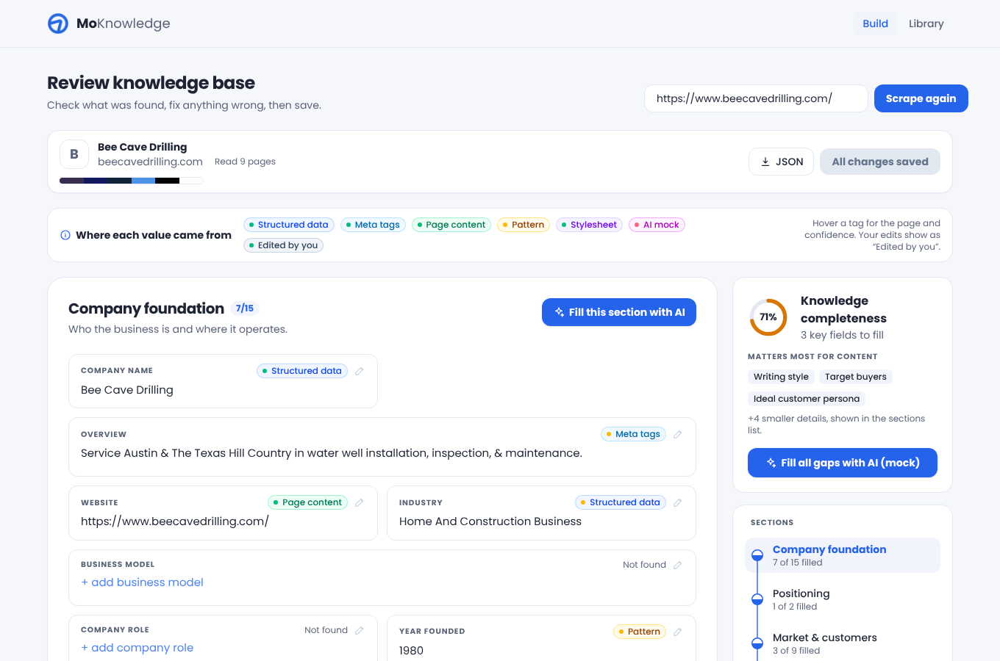
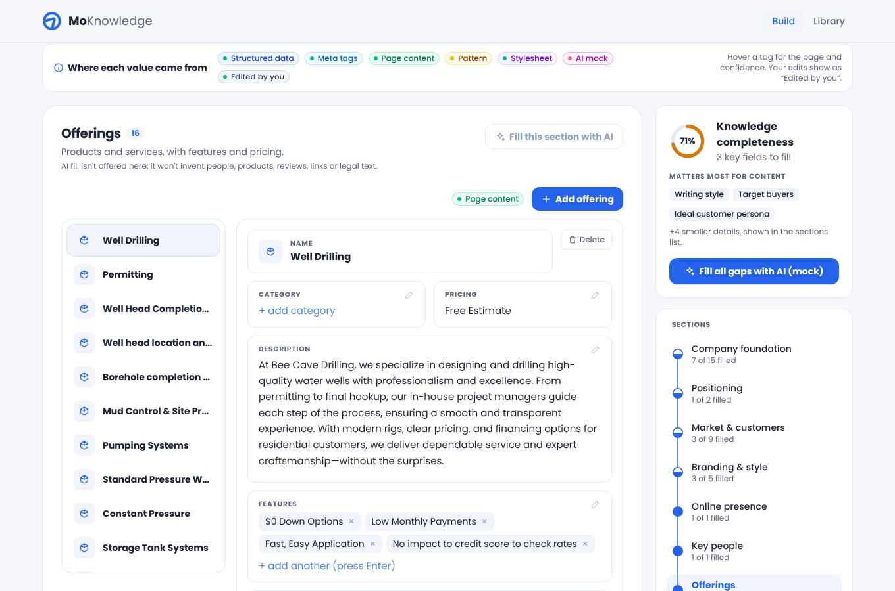
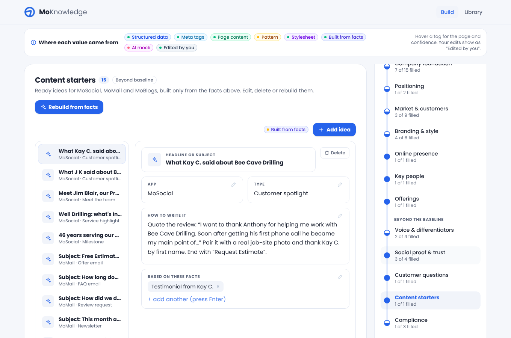

# MoKnowledge

MoKnowledge turns a small business's website into a structured, reviewable
knowledge base that MoSocial, MoMail and MoBlogs can use to write on-brand,
specific content.

You enter a URL. It reads the site's most useful pages, extracts everything
it can (from structured data down to brand colors and real customer quotes),
shows where each value came from, lets you fix and fill gaps, and saves the
result as JSON.



---

## Run it

Requires Node 18.18+ (20+ recommended).

```bash
npm install
npm run dev
```

Open http://localhost:3000/knowledge, enter a website (for example
`beecavedrilling.com`), and press **Build knowledge base**.

| Command | What it does |
| --- | --- |
| `npm run dev` | Development server |
| `npm run build && npm start` | Production build |
| `npm run test:fixture` | Runs every extractor on saved HTML in `fixtures/` (no network) |
| `npm run replay -- captures/<site>.json [--save out.json]` | Runs the **whole real pipeline** (crawler included) against a saved copy of a real website (see [Testing on real sites](#testing-on-real-sites)) |
| `npm run typecheck` | TypeScript check |
| `npm run lint` | ESLint |

Saved knowledge bases are written to `data/knowledge/<id>.json`.

---

## Features

**Build page (`/knowledge`)**
- URL input with validation (adds `https://`, rejects malformed and private/local addresses).
- Live progress while scraping, streamed from the server step by step.
- Results grouped into 12 sections: the 7 baseline categories plus 5 "beyond baseline" sections, shown **one section at a time** in a layout modeled on MoFlo Cloud (field cards with labels and an edit pencil, Next/Previous, and a section switcher on phones).
- **Section stepper** in the sidebar: each section's dot is filled when complete, half-filled while information is missing, and empty when nothing was found.
- Every field is editable: text, lists, colors, photos, and lists of records (people, offerings, testimonials, FAQs, social profiles, content ideas) in a **list + detail** editor like MoFlo's Business Offerings screen.
- **Color picker** for brand colors: pick visually (saturation/brightness square + hue slider) or type an exact hex code, with RGB/HSL shown.
- **Key people photos**: upload, replace or remove a photo per person (resized to 256px in the browser).


- **Source tags on every value**: Structured data, Meta tags, Page content, Pattern, Stylesheet, Built from facts, AI mock, or Edited by you, with a confidence dot. Hover for the page it came from. A legend at the top of the review page explains them.
- **Completeness score** weighted by how much each field helps content generation. The card lists only the **key** missing fields (the ones that matter most for content); smaller gaps show in the stepper.
- **Brand photo library**: the business's real photos (team, projects, services) pulled from the site, filtered to skip logos, icons, review badges, star ratings and reviewer avatars, and labeled "Stock" when they come from a stock library. Curate them in Branding & style.
- **Team photos attached automatically**: when a team page captions headshots with names (Bee Cave Drilling does), each key person gets their photo. You can also upload or replace one.
- **Content starters**: 10-15 ready ideas per company for MoSocial (customer spotlights, meet the team, milestones), MoMail (offer, FAQ, review-request emails) and MoBlogs (answer articles, local service guides, comparisons). Each one quotes the facts it's built on, is generated by rules (no AI, so nothing is invented), and can be edited or rebuilt after you fix the facts.



- **Fill with AI (mock)**, per section or for all gaps at once: fills only empty, AI-fillable fields with clearly labeled placeholders and shows the exact prompts a real model would receive. It's deliberately not offered for people, products, reviews, links or legal text, which AI should never invent.
- Save to library, download JSON, warn before leaving with unsaved edits.
- Warnings for partial results (JavaScript-rendered sites, pages blocked by robots.txt).

**Library page (`/knowledge/view`)**
- Three views: **Cards** (identity, color strip, completeness), **Table** (scan many), **Details** (list + full read-only view with source tags).
- Search across name, website, industry, overview, services and locations. Filter by industry. Sort by updated, name or completeness.
- Edit, re-scrape, export JSON, and delete (with inline confirmation).
- Remembers your preferred view.

**Responsive** down to phone width, keyboard accessible, respects reduced motion.

---

## How scraping works

```
URL ─▶ validateUrl ─▶ crawlSite ─▶ parsePage ─▶ extractors ─▶ mergeResult ─▶ KnowledgeBase JSON
```

### 1. Crawl the right pages (`src/lib/scraper/crawl.ts`)

A homepage alone misses most of what matters: the founding story is on
/about, services on /services, the team on /team. So the crawler:

1. Fetches the homepage, `robots.txt` and the sitemap (`sitemap.xml`, `sitemap_index.xml`, WordPress `wp-sitemap.xml`, and nested sitemap indexes).
2. **Reads the main menu** (`siteMenu.ts`). Small businesses organize their site in the menu: a "Services" dropdown lists every service, "About Us" holds the story and team. Links under those get a big bonus. For Framer/Webflow sites with no `<ul>` menu, it falls back to the links in `<header>`/`<nav>`, and to link columns headed "Products"/"Services" (often in the footer).
3. **Scores every other link and sitemap URL** by how likely it is to hold knowledge (about > team > services > contact/FAQ > testimonials > blog > legal). Form and account pages (quote, payment, careers, login) are penalized, and individual blog posts score low (the blog index is enough).
4. Fetches the top 11 alongside the homepage, 4 at a time, at most 5 service pages so the about/team/FAQ pages still make it in. 12-second timeout and 3 MB cap per page.
5. Follows `robots.txt` properly: `*` and `$` wildcards, longest-match wins between Allow and Disallow, and `Crawl-delay` (reads one page at a time with a capped pause, and tells the reviewer).
6. Also downloads the site's own stylesheets (for colors and fonts).

### 2. Extract, from most to least reliable (`src/lib/extractors/`)

Each extractor is a pure function: parsed pages in, partial knowledge base
plus sources out. That makes them testable with saved HTML.

| Extractor | Reads | Produces |
| --- | --- | --- |
| `jsonLd` | schema.org JSON-LD (incl. `@graph`) | name, overview, founding year, address, phone, email, industry (from `@type`, e.g. `Plumber`), service areas, founder, logo, rating, reviews, FAQPage |
| `socials` | header/footer links + `sameAs` | social profiles (skips share buttons) |
| `details` | `tel:`/`mailto:` links, `<address>`, text patterns | phone, email, address, year founded ("since 1980"), legal entity (from the © line), service areas ("serving X, Y and Z"), privacy/terms links |
| `branding` | inline + external CSS, `<link>` tags | brand colors ranked by use (named `--primary`/`--brand` variables and `theme-color` weighted 5×, theme/plugin defaults like Divi's and WordPress's skipped, neutrals ranked last), fonts (Google Fonts first, then `font-family`), logo |
| `structure` | menu, links, buttons, forms, headings | offerings (from the menu's Services/Products items, else top-level menu items that aren't navigation, else `/services/*` links; then each page's description, features and pricing), CTAs, funnels (each form classified as quote/contact/newsletter/booking), channels (phone, email, live chat), key people (name + role on team pages), content themes |
| `socialProof` | blockquotes, review blocks, `<details>`, Q&A headings, sentences | testimonials, FAQs, trust signals, differentiators, press, community/values, seasonal promos, legal disclaimers |
| `voice` | About + homepage paragraphs | voice samples, founding story, pitch draft |
| `images` | `` tags (srcset, lazy-load attributes) outside header/footer | brand photo library with a category per photo |
| `meta` | `<title>`, meta description, Open Graph | fallback name, overview, image |

### 3. Merge with provenance (`src/lib/knowledge/merge.ts`)

- Single values: keep the existing value unless a new one is **more confident**.
- Lists: union and de-duplicate. Objects that describe the same thing (same person name, same FAQ question) are **combined**, so "Maria Torres, Founder" from JSON-LD and "Maria Torres, Owner & Master Plumber, <bio>" from the team page become one person.
- After merging, `derive.ts` connects facts across extractors: it matches headshots to key people (by alt text or file name) and builds the content starters from offerings, FAQs, testimonials, people and seasonal offers. These are tagged **Built from facts**.
- Every field's origin goes into `sources`:
  `"foundation.yearFounded": { "method": "json-ld", "confidence": "high", "url": "https://…" }`

---

## Testing on real sites

Saved HTML fixtures prove each extractor works, but real sites are messier.
To test against them repeatedly without hammering their servers:

1. Open the site in a browser and paste `captures/capture-snippet.js` into the DevTools console. It saves the homepage, robots.txt, sitemaps, menu/header/footer pages and stylesheets into one JSON file.
2. `npm run replay -- captures/<site>.json` swaps `fetch` for the saved copy and runs the real pipeline, crawler included. Anything the crawler asks for that wasn't captured is listed, so you can capture it too.

I did this with three of the example companies. Results are in `examples/`:

| Site | Pages read | What it found | What it taught me |
| --- | --- | --- | --- |
| [beecavedrilling.com](examples/beecavedrilling.json) | 9 | Founded 1980, phone, address, 16 services, 15 team members **with their photos**, 10 reviews, 5 FAQs, Yelp + Facebook, 15 content starters | Services live at `/pumping-systems/`, not `/services/` → read the menu. "Request a quote" pages aren't services. Divi theme's default blue isn't the brand. `robots.txt` asks for a 30s Crawl-delay. |
| [planetorange.com](examples/planetorange.json) | 10 | 3 service lines, 4 reviews, blog topics, Raleway font, 24 site photos (one labeled Stock), 10 content starters | Services are top-level menu items ("Termite Control"), not under "Services". Old-style Google Fonts URLs (`Roboto:300\|Open+Sans`). WordPress admin colors leak into CSS. |
| [moflo.ai](examples/moflo.json) | 10 | 4 products with prices ($149/mo, $79/mo), 30 FAQs, 6 socials, `#2663eb` + Poppins, team portraits, 9 content starters | Framer has no `<ul>` menu; products are only in a footer column. Repeated headings for mobile/desktop. "Poppins Placeholder" fallback fonts. |

Captures are git-ignored (they're large, and copies of other companies' sites).

---

## Knowledge base schema

The full type is in [`src/types/knowledge.ts`](src/types/knowledge.ts). A complete example is in
[`examples/`](examples/).

```ts
KnowledgeBase {
  id, sourceUrl, createdAt, updatedAt, scrapedPages[]
  foundation      { name, overview, website, industry, businessModel, companyRole, yearFounded,
                    legalEntityType, employeeCount, mainAddress, otherLocations[], serviceLocations[],
                    altNames[], phone, email }
  positioning     { pitch, foundingStory }
  market          { buyers[], customerNeeds, idealPersona, industryGroupings[], industryOutlook,
                    channels[], funnels[], ctas[], suppliers[] }
  branding        { writingStyle, artStyle, fonts[], colors[], logos[],
                    images[{ url, alt, category, page }] }
  onlinePresence  { socials[{ platform, url }] }
  people[]        { name, title, gender, description, photo? }
  offerings[]     { name, category, description, features[], pricing, url }
  extras          { voiceSamples[], uniqueSellingPoints[], testimonials[{ quote, author, rating }],
                    faqs[{ question, answer }], trustSignals[], contentThemes[], pressMentions[],
                    communityAndValues[], seasonalMessaging[],
                    contentStarters[{ app, type, title, angle, basedOn[] }],
                    compliance { privacyPolicyUrl, termsUrl, disclaimers[] } }
  sources         { "<field.path>": { method, confidence, url? } }
}
```

### Beyond the baseline, and why

| Field | Why it makes content better |
| --- | --- |
| **Voice samples** | Real sentences from the site. Models imitate examples far better than they follow adjectives like "friendly and professional". |
| **Testimonials** | Real customer words for MoSocial spotlights and MoMail proof blocks, instead of invented praise. |
| **FAQs** | Each question is a ready-made blog post (MoBlogs) or email topic (MoMail), in the customer's own wording. |
| **Trust signals** | Licenses, warranties, ratings, years in business: specific claims to cite instead of "trusted and reliable". |
| **Differentiators** | What to emphasize against competitors. |
| **Content themes** | Topics the business already talks about, so new content stays consistent. |
| **Seasonal messaging** | Existing promos and timing, so campaigns land at the right time of year. |
| **Community & values, press** | Human, local stories for social posts and credibility. |
| **Brand photos** | The company's own team and job-site photos for MoSocial, instead of stock images. Stock photos found on the site are labeled so they aren't passed off as the business's work. |
| **Content starters** | Concrete things to write this week for each app, each quoting the facts it uses. Turns "who is this company" into "what should we say, to whom". |
| **Compliance** | Disclaimers ("subject to credit approval", "NMLS #") that generated content must respect, so MoMail never promises what the business legally can't. |
| **Provenance (`sources`)** | Lets a person verify quickly, and lets an LLM know which facts are safe to state as fact. |

---

## Prompts for AI enrichment

MoKnowledge does **not** call an LLM. The fields a model would write
(pitch, persona, writing style, art style...) can be filled with **mock**
values, tagged `ai_mock` in the data and shown with an "AI mock" badge.
The prompts a real implementation would send are in
[`src/prompts/index.ts`](src/prompts/index.ts), and the app shows them with
real scraped data after you press **Fill all gaps with AI (mock)** or a
section's **Fill this section with AI**.

| Prompt | Fills |
| --- | --- |
| Market & positioning profile | pitch, buyers, customer needs, ideal persona, industry groupings, business model, company role |
| Writing style & brand voice guide | writing style, plus do/don't lists and signature phrases |
| Offerings cleanup & categorization | offering categories, features, pricing, duplicate detection |
| Differentiators & content angles | unique selling points, content themes |
| Visual / art style (vision model) | art style and image guidance |

Every prompt follows the same rules:
- **Role + purpose**: the model knows its output feeds MoSocial/MoMail/MoBlogs.
- **Data separated from instructions** inside `<scraped_data>` tags, so text on a website can't act as instructions (prompt injection).
- **Exact JSON output schema** so results drop straight into the knowledge base.
- **Grounding**: use only the scraped data, return `null` instead of guessing, and quote evidence (phrase + URL) for every field.
- **A good vs. bad example** to set the quality bar (specific facts over generic hype).
- **Only the needed data** is sent: smaller input, less distraction, lower cost.

Excerpt:

```
Return JSON with this schema:
{
  "pitch": string | null,   // 3–5 sentences in the company's own voice ...
  ...
  "evidence": { "field": string, "quote": string, "url": string }[]
}
Good pitch: "Family-owned since 1980, Bee Cave Drilling builds water wells across the Texas Hill Country..."
Bad pitch:  "Bee Cave Drilling is a leading provider of innovative water solutions committed to excellence."
```

---

## Data quality: handling missing information

1. **Fallback chain per field.** Each field is tried from the most reliable source down: JSON-LD → explicit HTML (`tel:`, `<address>`) → text patterns → meta tags → AI inference (labeled) → empty. Higher confidence always wins.
   Values built by rules from other fields (content starters) are tagged "Built from facts" and list the facts they use.
2. **Never guess silently.** If nothing supports a value, it stays empty. Mock AI values are visibly labeled and never overwrite scraped or human-entered values.
3. **Confidence per field.** Patterns are "medium" or "low"; structured data "high". Reviewers know what to double-check.
4. **Tell the user what's missing.** The completeness score and missing-field list turn gaps into a short to-do list.
5. **Degrade gracefully.** If one extractor throws, the rest still run and a warning is shown. Sites that render with JavaScript and pages blocked by robots.txt are flagged.
6. **Human edits are final.** Anything a person types is tagged "Edited by you" and is never overwritten by AI fill.

## Enrichment ideas beyond the website

- **Google Business Profile / Places API**: hours, categories, rating, review count, photos, and real reviews (strong voice-of-customer language).
- **Review sites** (Yelp, BBB, Angi, Houzz, Zillow for agents): testimonials, complaints to address, accreditation.
- **State business registries** (e.g. Nevada SilverFlume, Texas SOSDirect): legal entity type, formation date, officers.
- **Professional license lookups** (contractor boards, NMLS, state insurance and real estate boards): license numbers and status as trust signals.
- **LinkedIn company page**: employee count, specialties, key people.
- **The business's social posts**: real tone on each platform, posting cadence, what performs.
- **Competitors** (same category + city via Places): differentiation and local keyword gaps.
- **Search data** (Search Console, if connected): what customers actually search to find them, for MoBlogs topics.
- **Wayback Machine**: history and past offerings, useful for a founding story.
- **The customer themselves**: a 5-question onboarding prompt for anything still missing ("What do customers thank you for most?").

---

## Database design

The app stores JSON files to keep the assignment self-contained, behind a
`KnowledgeRepository` interface (`src/lib/storage/`) so a database can be
swapped in without UI changes.

The production design is [`supabase/schema.sql`](supabase/schema.sql)
(tested on Postgres 16, including RLS):

- `organizations`, `organization_members`: MoFlo customer accounts and roles.
- `companies`: one per business per org, unique by domain, pointing to its current version.
- `scrape_runs`, `scraped_pages`: every scrape and its raw pages (HTML in Storage), so extractors can be improved and re-run without re-crawling.
- `knowledge_versions`: **append-only** full JSONB snapshots with a version number, status (draft/published/archived) and change note. JSONB keeps the schema flexible as new fields are added; `industry` and a full-text `search` column are generated from it for filtering.
- `field_provenance`: a queryable copy of `sources` ("show every field a person edited").
- **RLS** on every table: members see only their organization's data; deleting companies is admin-only; versions can't be rewritten, only their status changed. The scraper uses the service role on the server only.

---

## Project structure

```
src/
  app/
    knowledge/page.tsx           Build & review page
    knowledge/view/page.tsx      Library: cards / table / details
    api/scrape/route.ts          POST: scrape, streamed as NDJSON progress events
    api/enhance/route.ts         POST: mock AI fill + the prompts it would send
    api/knowledge/…              GET/POST list, GET/PUT/DELETE by id
  components/
    knowledge/                   editor context, section card, stepper, field editors, source tags, completeness…
    ui/                          icons, color picker, photo upload
    library/                     detail view, item actions
  lib/
    scraper/                     fetch, robots.txt, menu reading, crawl, parse, URL validation
    extractors/                  one file per kind of information
    knowledge/                   empty KB, merge rules, derive (photos → people, content starters),
                                 completeness, section config, paths
    ai/mockEnhance.ts            labeled placeholder enrichment
    storage/                     repository interface + JSON file implementation
    client/                      browser-side API helpers
  prompts/                       LLM prompt definitions
  types/knowledge.ts             the KnowledgeBase type
supabase/schema.sql              production database design
fixtures/                        saved HTML for offline extractor tests
examples/                        knowledge base JSON from 3 real sites + the fixture
scripts/                         test-fixture.ts, replay.ts (offline runs)
captures/capture-snippet.js      browser snippet that saves a site for replay
public/                          MoFlo logo (blue and white versions)
```

---

## Assumptions and limitations

- **JavaScript-rendered sites** (some Wix/React sites) send little HTML until scripts run. The scraper detects this and warns. A headless-browser fallback (Playwright) is the next step. (Framer sites like moflo.ai are server-rendered, so they work.)
- **Brand colors from CSS only.** Many small businesses' real brand color is only in their logo image (Planet Orange's orange isn't in its CSS). Extracting the dominant colors from the logo is a clear next step.
- **Crawl-delay is respected in spirit, not to the letter.** A site asking for 30 seconds between requests would make a 12-page scrape take 6 minutes, so we read one page at a time with a capped 1.5s pause and tell the reviewer.
- **Photos are linked, not copied.** Brand photos point at the business's own site, so a photo can disappear if they change their site. Uploaded people photos are stored in the JSON as small data URLs; in production both would go to Supabase Storage.
- **Content starters are templates.** They're reliable because they only reuse real facts, but the wording is formulaic; a real LLM (with the same grounding rules) would write them more naturally.
- **US-centric patterns** for phone numbers and addresses.
- **Heuristics, not understanding.** Team members, testimonials and FAQs are found by page structure. Unusual layouts can be missed or misread, which is why every field is reviewable and tagged.
- **No LLM calls**, per the assignment. AI-only fields are mock placeholders and labeled as such.
- **Local JSON storage** is single-user and not meant for production (see the Supabase design).
- **Politeness**: respects robots.txt, caps pages and concurrency, identifies itself with a User-Agent.
- **Security**: blocks private/local addresses (SSRF), restricts storage IDs to UUIDs (path traversal), validates request bodies.
